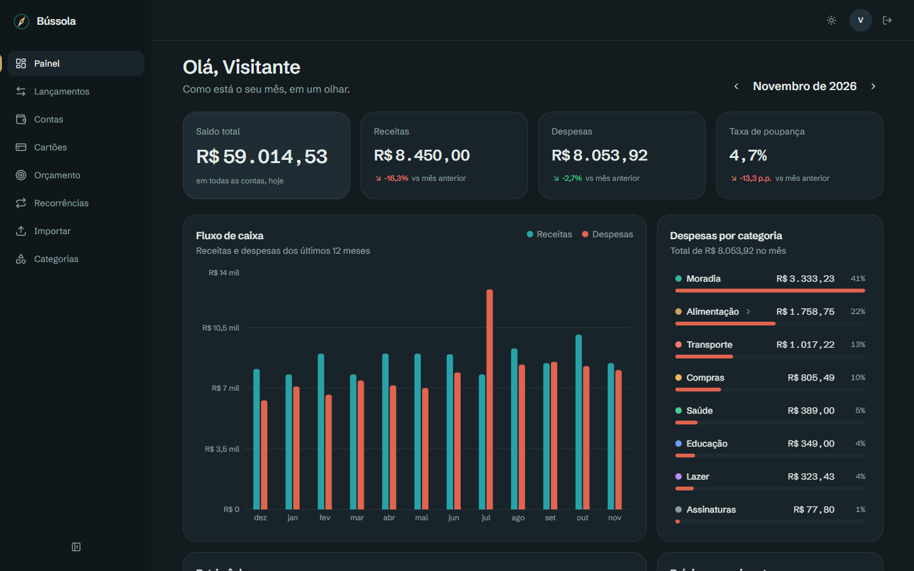
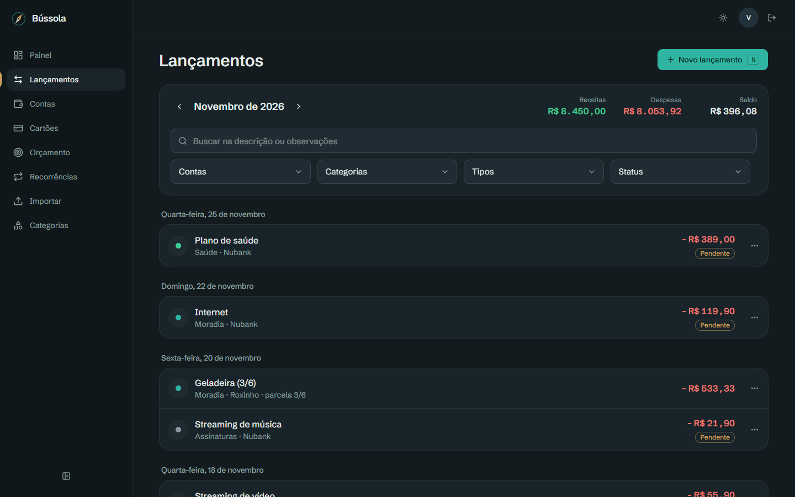
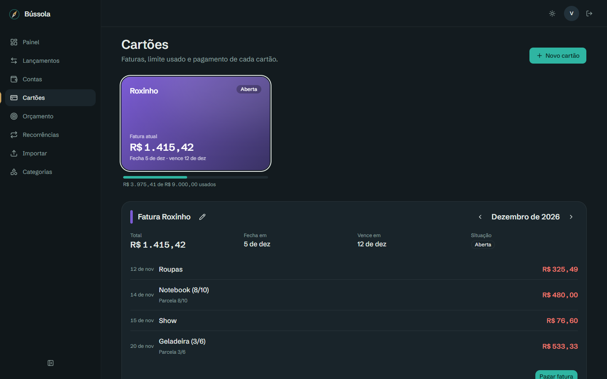
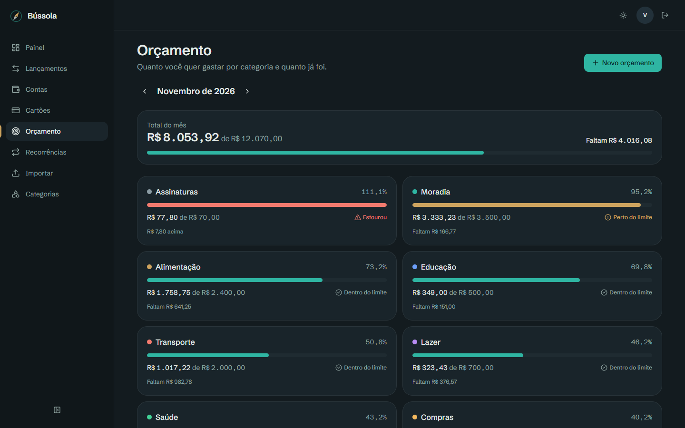
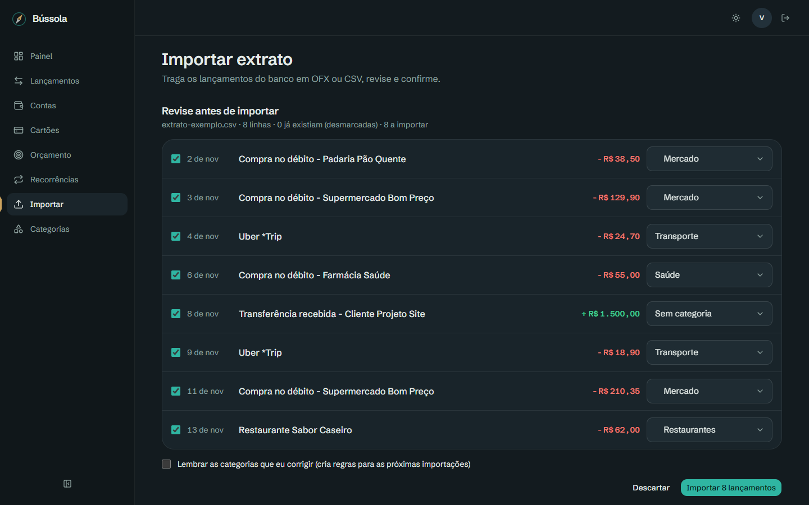
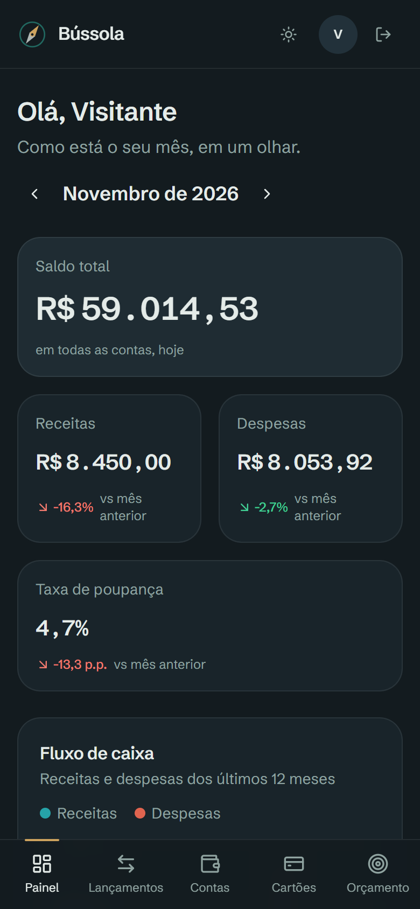
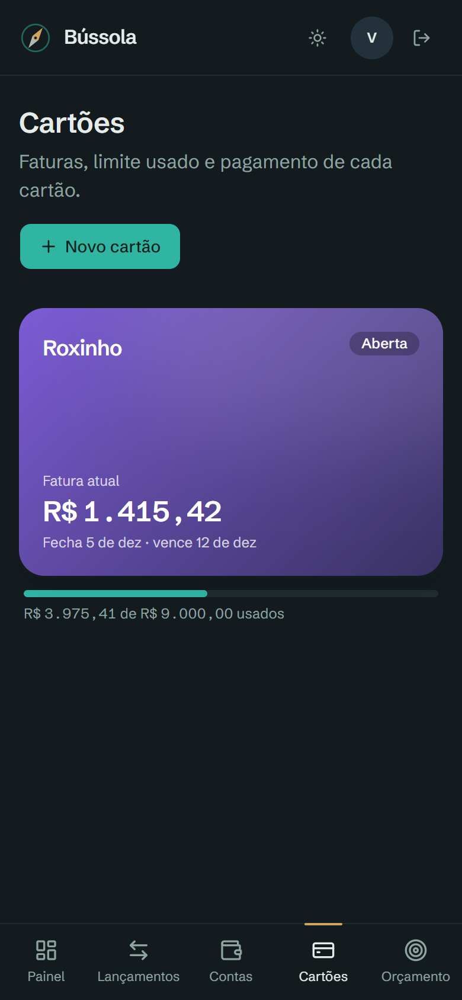
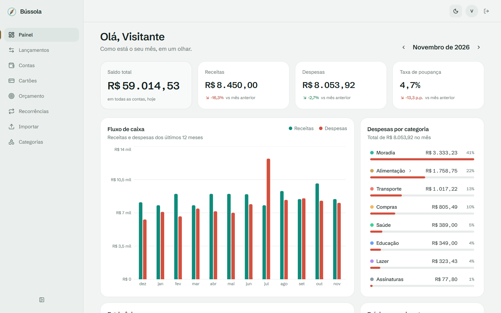
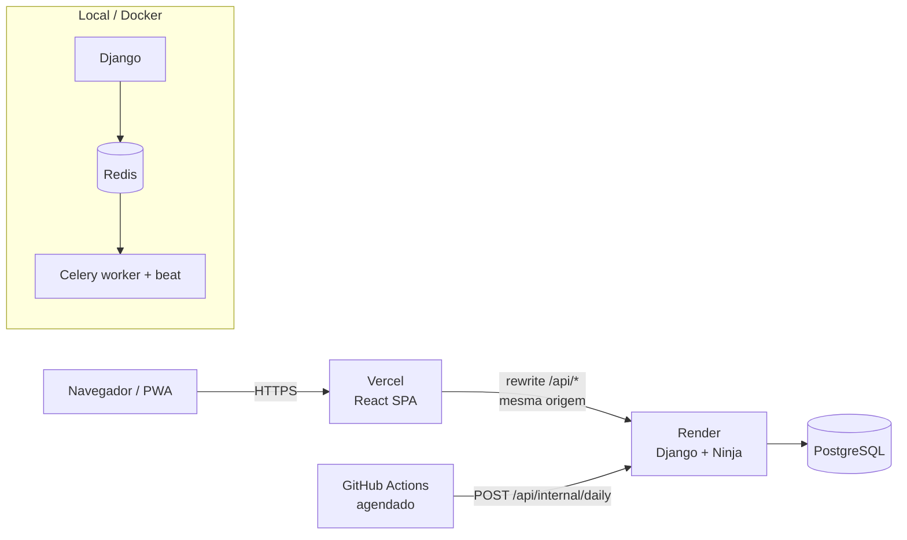

# 🧭 Bússola Financeira

Controle financeiro pessoal com dashboards. Reúne contas, cartão de crédito com faturas e parcelas, recorrências, orçamento por categoria e importação de extrato OFX/CSV, numa interface responsiva, animada e instalável como app (PWA).

> Projeto de portfólio fullstack **Python + React**.
>
> **Experimente sem cadastro:** na tela de login, clique em **Entrar como visitante**. A conta tem 12 meses de dados de exemplo.



| Lançamentos | Cartão e fatura |
|---|---|
|  |  |
| **Orçamento** | **Importação de extrato** |
|  |  |

<p align="center">
  
  &nbsp;&nbsp;
  
  &nbsp;&nbsp;
  
</p>

## ✨ Funcionalidades

- **Lançamentos:** receitas, despesas e transferências, com categorias (um nível de subcategoria), tags, filtros na URL e atalho `N`.
- **Cartão de crédito:**
  - As compras caem na fatura certa pelo dia de fechamento, e o limite usado é acompanhado.
  - **Pagar a fatura** é uma transferência da conta para o cartão: o gasto não é contado duas vezes.
- **Parcelamentos:** o centavo que sobra da divisão vai na 1ª parcela, e as parcelas caem em faturas consecutivas.
- **Recorrências:** salário, aluguel e assinaturas viram lançamentos pendentes até 60 dias à frente, sem duplicar.
- **Orçamento** por categoria: avisa em 80% e em 100%, copia do mês anterior e lista os gastos sem orçamento.
- **Importação de extrato OFX/CSV:**
  - Prévia com duplicados detectados e categoria sugerida.
  - Regras que aprendem com as suas correções.
  - Dá para desfazer.
- **Painel:** KPIs com variação mensal, fluxo de caixa de 12 meses, despesas por categoria, patrimônio, próximos vencimentos, orçamento e maiores gastos.
- **Visitante:** entra com um clique numa conta com 12 meses de dados realistas, que se reinicia todo dia.

## 🔎 Destaques técnicos

- **API tipada de ponta a ponta:** o Django Ninja gera o OpenAPI, e o orval gera hooks TanStack Query e os tipos do front. O CI falha se front e API ficarem fora de sincronia.
- **Dinheiro sempre em `Decimal`** no backend, trafegando como string. No front, a soma e a divisão de parcelas são feitas em centavos inteiros (nunca float).
- **Modelo contábil explícito:** constraints no banco garantem conta **ou** cartão, cartão só para despesa e transferência com exatamente um destino. Faturas pagas ficam travadas.
- **Segurança:** sessão por cookie httpOnly + CSRF na mesma origem (rewrite do Vercel), sem JWT no `localStorage`. Toda consulta é filtrada pelo usuário, e IDs de outra pessoa respondem 404.
- **Testes:** ~280 no backend (pytest) e ~130 no front (Vitest + Testing Library). Cada fase passou por revisão de código, e cada achado ganhou um teste de regressão.
- **Acessibilidade:** auditoria com axe-core sem violações sérias nos dois temas, contraste AA, link "pular para o conteúdo", tabela equivalente para cada gráfico e respeito a `prefers-reduced-motion`.
- **Gráficos com cores validadas para daltonismo** (deuteranopia e protanopia) em cada tema.
- **Desempenho:** páginas carregadas sob demanda, bibliotecas em chunks próprios e pré-carga no tempo ocioso. O service worker nunca guarda respostas da API.

## 🛠️ Stack

| Camada | Tecnologias |
|---|---|
| Backend | Python 3.13, Django 5, Django Ninja (OpenAPI), PostgreSQL, Celery + Redis, WhiteNoise |
| Frontend | React 19, TypeScript, Vite, TanStack Query, React Router, Tailwind CSS, shadcn/ui (Base UI), Motion, Recharts, PWA |
| Qualidade | pytest, factory_boy, Vitest, Testing Library, Ruff, oxlint, Prettier, axe-core, GitHub Actions |
| Infra | Docker Compose, Render (API + Postgres), Vercel (front) |

## 🏗️ Arquitetura



- **Produção:** as tarefas diárias (gerar recorrências e reiniciar a demo) rodam por um endpoint interno protegido, chamado por um workflow agendado. Assim o plano gratuito não precisa de worker.
- **Docker e local:** as mesmas tarefas rodam no Celery beat.

## 🚀 Como rodar

### Com Docker
```bash
docker compose up --build
```
Front em http://localhost:5173 · API em http://localhost:8000/api/docs. O compose sobe Postgres, Redis, a API, o worker, o beat e o front.

### Sem Docker
Requisitos: Python 3.13 e Node 24.

```bash
# API (SQLite por padrão; sem Redis as tarefas rodam na hora)
cd backend
cp .env.example .env
python -m venv venv
source venv/bin/activate         # Windows: venv\Scripts\activate
pip install -r requirements-dev.txt
python manage.py migrate
python manage.py runserver

# Front (outro terminal)
cd frontend
npm install
npm run dev
```

Para testar a importação, use os arquivos de [`docs/exemplos/`](docs/exemplos/).

### Testes e qualidade
```bash
cd backend && pytest && ruff check .   # com o venv ativo
cd frontend && npm test && npm run lint && npm run typecheck
```

## ☁️ Deploy (Render + Vercel)

Tudo está versionado: [`render.yaml`](render.yaml), [`frontend/vercel.json`](frontend/vercel.json) e [`.github/workflows/daily.yml`](.github/workflows/daily.yml). Os passos manuais:

1. **Render:** New → **Blueprint** → escolha este repositório. Isso cria a API (`bussola-api`) e o Postgres.
2. **Vercel:** New Project → este repositório, com **Root Directory** = `frontend`.
   - Se o serviço no Render tiver outro nome, ajuste o destino do rewrite de `/api` em `vercel.json`.
3. **No Render**, preencha `CSRF_TRUSTED_ORIGINS` com a URL do Vercel (ex.: `https://bussola-financeira.vercel.app`).
4. **No GitHub** (Settings → Secrets and variables → Actions):
   - Variável `PROD_API_URL`: a URL do Render.
   - Secret `CRON_SECRET`: o mesmo valor gerado no Render.

## 📚 Documentação

- Design do projeto: [docs/specs/2026-11-13-bussola-financeira-design.md](docs/specs/2026-11-13-bussola-financeira-design.md)
- Specs e planos de cada fase: [docs/specs/](docs/specs/) e [docs/planos/](docs/planos/)
- Documentação viva por área: [docs/documentacao/](docs/documentacao/README.md)
- API interativa (com o projeto rodando): `http://localhost:8000/api/docs`

## 🗺️ Roadmap

- [x] Fase 1: Fundação (monorepo, Docker, CI, auth, esqueleto do front)
- [x] Fase 2: Contas, categorias e lançamentos
- [x] Fase 3: Painel + usuário demo
- [x] Fase 4: Cartões, parcelamentos e recorrências
- [x] Fase 5: Orçamento
- [x] Fase 6: Importação OFX/CSV
- [x] Fase 7: PWA, acessibilidade, desempenho e configuração de deploy
- [ ] Depois: metas de economia, exportação CSV/PDF, relatórios por tag, notificações de vencimento
